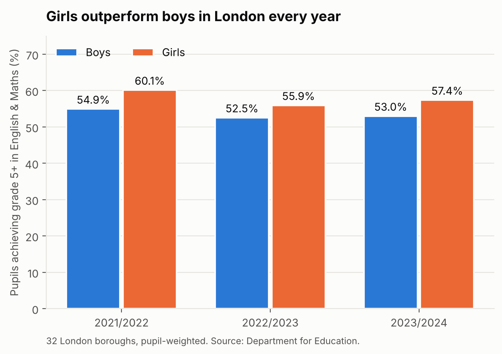
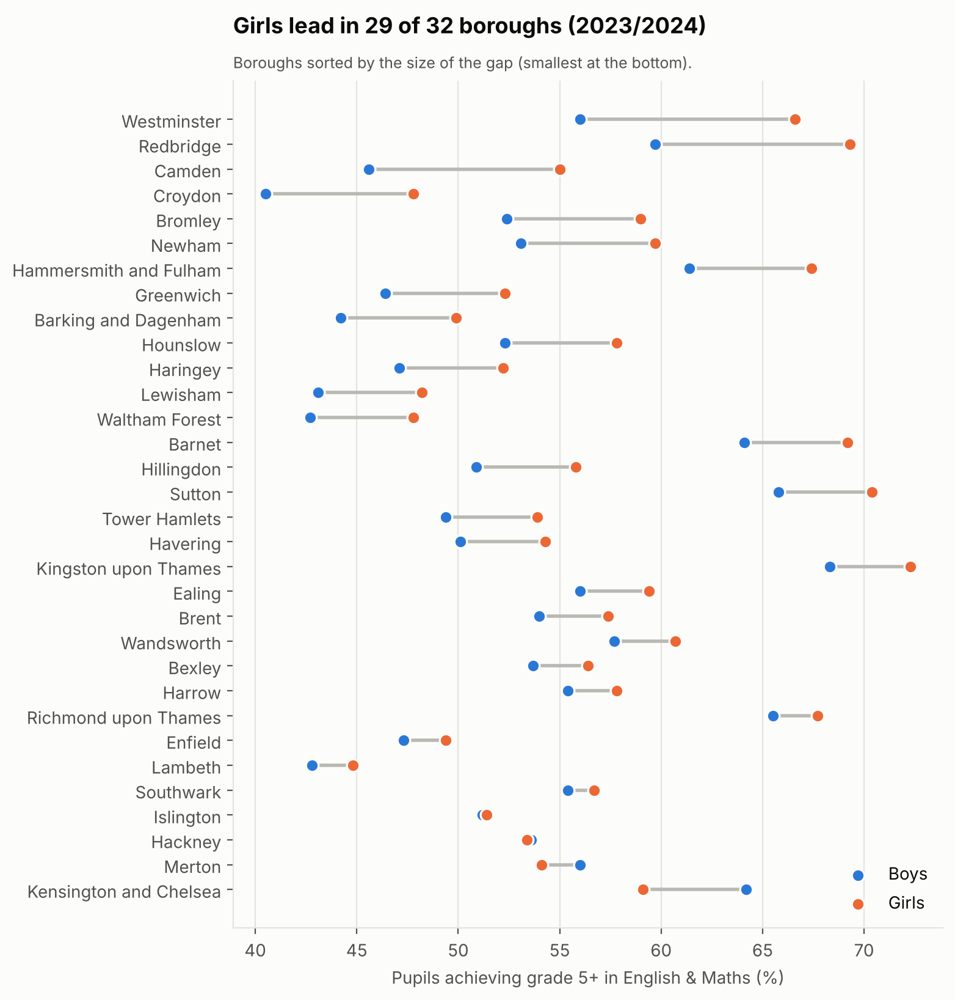
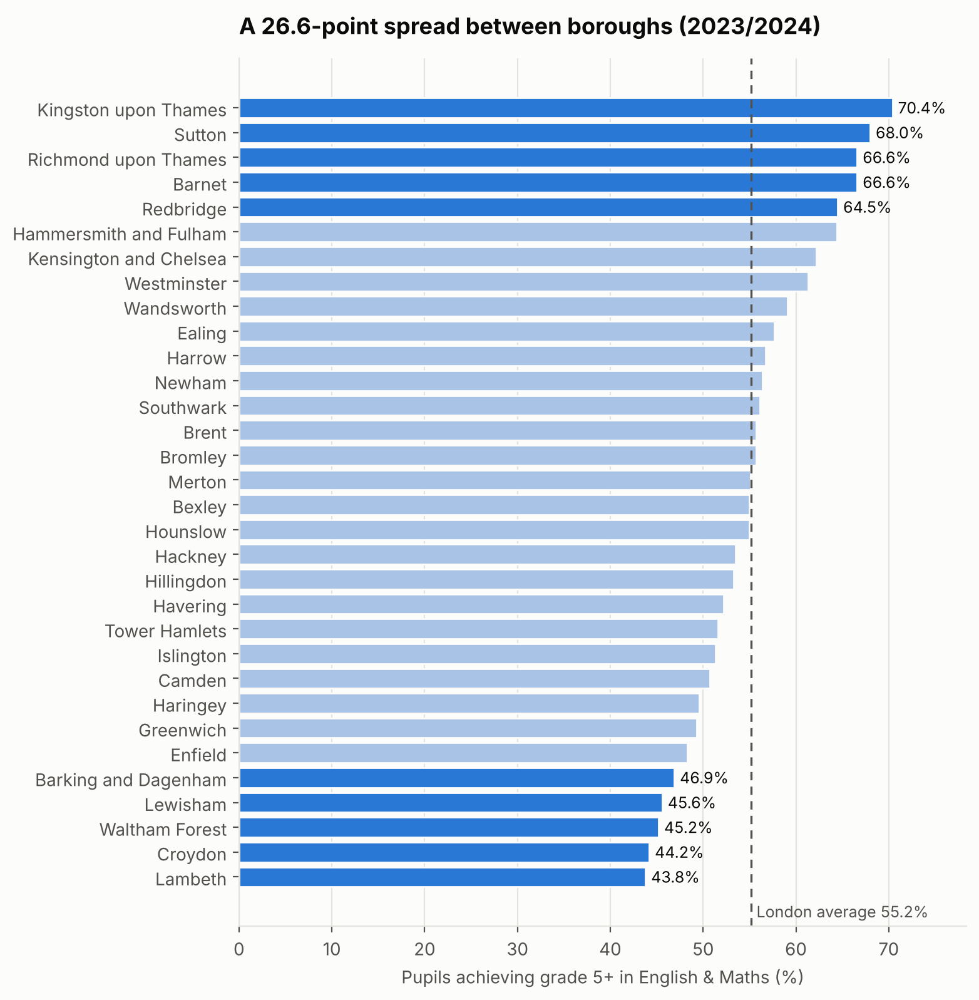
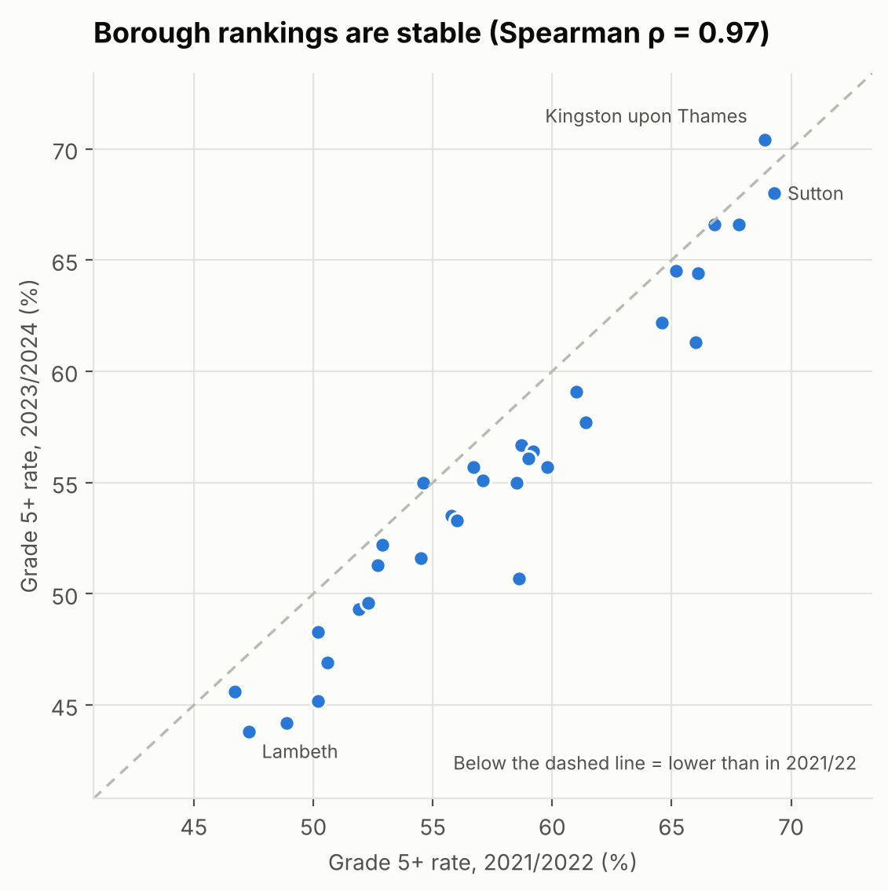

# GCSE attainment in London: boys vs girls and borough differences

Exploratory data analysis of GCSE results for the 32 London boroughs over three school years
(2021/22 to 2023/24), built with Python (pandas, SciPy, matplotlib).

Two questions:

1. **Do girls and boys perform differently in GCSE English and Maths, and is the difference statistically meaningful?**
2. **How much do boroughs differ, and are the same boroughs ahead every year?**

The project started as a university data analysis assignment. This version re-implements it as a
reproducible script, adds the statistical tests, and fixes data-quality problems found in the raw file
(listed below).

## Key findings

| London (pupil-weighted) | Boys | Girls | Gap (girls - boys) |
|---|---|---|---|
| 2021/22 | 54.9% | 60.1% | 5.2 pp |
| 2022/23 | 52.5% | 55.9% | 3.4 pp |
| 2023/24 | 53.0% | 57.4% | 4.4 pp |

*Share of pupils achieving grade 5 or above in both English and Maths.*



**Gender.** Girls outperform boys on every measure. Averaged over the three years, the gap in grade 5+ is
**4.3 percentage points (95% CI 3.4 to 5.2)**, and girls are ahead in **31 of 32 boroughs**
(paired t-test and Wilcoxon signed-rank test, both p < 0.001; Cohen's d_z = 1.7). The gap is similar
for grade 4+ (4.1 pp), Attainment 8 (4.4 points) and Progress 8 (0.27 points). In the latest year, girls lead
in 29 of 32 boroughs; the three exceptions are Hackney, Merton and Kensington and Chelsea.



**Boroughs.** In 2023/24 the grade 5+ rate ranges from **43.8% (Lambeth) to 70.4% (Kingston upon Thames)**,
a spread of 26.6 pp around a London average of 55.2%. The ranking is very stable: Spearman rank correlation
between 2021/22 and 2023/24 is **0.97**, so the same boroughs sit at the top and bottom every year.

| Top 5 (2023/24) | | Bottom 5 (2023/24) | |
|---|---|---|---|
| Kingston upon Thames | 70.4% | Lambeth | 43.8% |
| Sutton | 68.0% | Croydon | 44.2% |
| Barnet | 66.6% | Waltham Forest | 45.2% |
| Richmond upon Thames | 66.6% | Lewisham | 45.6% |
| Redbridge | 64.5% | Barking and Dagenham | 46.9% |




All test results are in [`results/gender_gap_tests.csv`](results/gender_gap_tests.csv) and the full borough
ranking in [`results/borough_ranking.csv`](results/borough_ranking.csv).

## Method

1. **Load and map columns by position**, with header checks, because the sheet has three near-identical
   blocks (All / Boys / Girls) and it is easy to read the wrong one.
2. **Clean** (details below).
3. **Gender comparison:** within each borough, girls minus boys; paired t-test, Wilcoxon signed-rank test,
   95% confidence interval and effect size, per year and on the 3-year borough average
   (each borough counts once).
4. **Borough comparison:** ranking by all-pupil rate, top/bottom 5, and year-to-year stability
   (Spearman correlation).

### Data-quality issues found and handled

| Issue | Handling |
|---|---|
| Percentages stored on two scales (0-1 and 0-100), sometimes mixed within one row | Values above 1 divided by 100. Validated: the "All" rate equals the pupil-weighted average of the boys' and girls' rates (max difference 0.0008) |
| **City of London rows contain England-wide totals** (e.g. 624,275 pupils) | Excluded; analysis covers 32 boroughs |
| Camden 2022/23 appears twice | Exact duplicate removed |
| Regional and national aggregate rows in the same sheet | Removed (only ONS codes `E09...` kept) |
| Suppressed values (one borough-year, Lambeth boys' 5+ rate in 2022/23) | Left missing; that single test uses 31 boroughs |

## Limitations

- The data are **borough aggregates, not pupil-level**, so the analysis is descriptive. It shows that gaps exist,
  not why.
- Borough rates reflect who lives there (pupil intake, deprivation, school mix), **not school or local-authority
  quality**. No contextual variables are used.
- Grading arrangements changed across these years, so year-to-year movements in absolute rates should not be
  over-interpreted. Comparisons between boys and girls within a year are not affected by this.
- Three years are too few to say anything about long-term trends.

## Reproduce

```bash
python -m venv .venv
source .venv/bin/activate        # Windows: .venv\Scripts\activate
pip install -r requirements.txt
python src/analysis.py
```

The script prints the cleaning checks and all statistics, and writes `figures/` and `results/`.
It is also organised in `# %%` cells so it can be run step by step in Spyder or VS Code.

## Repository structure

```
data/gcse_by_sex.xlsx      raw data (sheet "Table1")
src/analysis.py            cleaning, statistics and figures
figures/                   charts used in this README
results/                   cleaned data and statistical result tables
```

## Data source

Department for Education (England), GCSE results by sex at local authority level, published on GOV.UK.
Source page: *add the link to the page you downloaded the file from*.
Contains public sector information licensed under the Open Government Licence v3.0.
